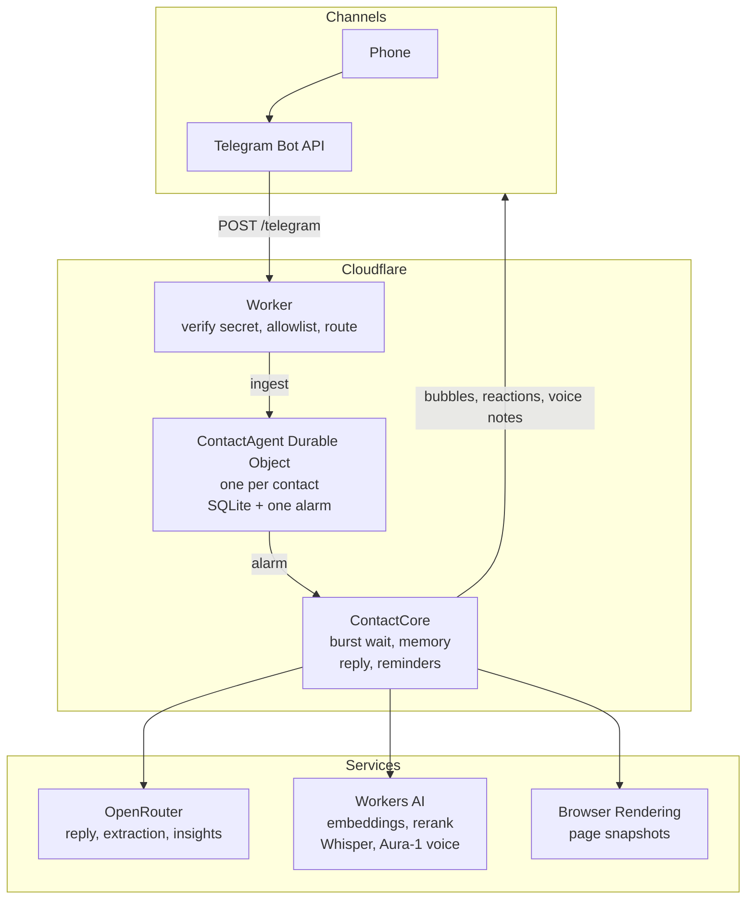

# wapp-agent

A Telegram assistant that remembers you. It runs on Cloudflare Workers. One Durable Object per contact keeps that person's chat, facts and insights in SQLite. Nothing is shared between contacts.

Repo: https://github.com/aldaonggar/wapp-agent. Worker: https://wapp-agent.alda-onggar.workers.dev (`/health` answers `ok` followed by the configured transports).

What was asked: [init.md](init.md). What was decided and why: [design](docs/superpowers/specs/2026-11-04-whatsapp-memory-agent-design.md). Manual setup done by the owner: [SETUP.md](SETUP.md). Verified API notes: [docs/superpowers/research/](docs/superpowers/research/).

## What it does and how to text it

Status (2026-11-05): the brief asked for WhatsApp, and the WhatsApp Cloud API transport is in the repo ([src/whatsapp.ts](src/whatsapp.ts)) and ran end to end in production (webhook, Durable Object, memory, model, send). Meta then permanently restricted the test account pending a business verification that needs company documents the owner does not have, so that transport is parked. Telegram, added the same day behind the same core, is the channel everything below refers to. The real-model evals ran on 2026-11-05 (see [Evals](#evals)).

- Replies like a person: it waits for a burst of messages to finish, then answers in short bubbles.
- Introduces itself on your first message: what it is and what it can do, in one or two bubbles.
- Reads photos, transcribes voice notes, and fetches pages for links you send.
- Looks things up on the web when it needs current information, telling you first.
- Remembers facts across days, works out things you did not say (insights), and forgets on request.
- Checks in later about plans that have a date.
- Sets reminders at an exact time: "remind me at 18:00 to call the dentist" gets a confirmation now and your own words back at 18:00; "what reminders do I have" lists them, and any can be cancelled.
- Answers a voice note with a voice note (one, carrying the whole reply), or when you ask for one ("say it out loud"); any other text message gets text.

To talk to it: open the owner's bot (the owner gives you its `t.me` link), press **Start**, and talk. The owner decides whether the bot is open to anyone who finds it or limited to a list of Telegram usernames or ids (`ALLOWED_TELEGRAM`, [SETUP.md section 9](SETUP.md)). Reminders and check-ins are delivered whenever they are due.

Things to try:

1. Send three short messages in a row. You should get one reply that covers all three.
2. Send a photo and ask about it.
3. Send a voice note.
4. Send a link.
5. Ask "what do you know about me".
6. Say "forget ..." and a fact. Ask about it later.
7. Come back the next day and refer to something you said earlier.
8. Mention a plan with a date (for example a trip next week) and wait for the check-in.
9. Say "remind me in 20 minutes to ..." and wait; ask "what reminders do I have" or cancel one.
10. Send a voice note and get a voice note back, or type "say that out loud" and get one.
11. Ask something that needs a search ("is the Louvre open today?"): it says it is checking, then answers from what it found.

## Architecture



The Worker is stateless: it checks Telegram's secret header and the allowlist, then hands the message to the one Durable Object named after the contact (`tg:<chat id>`). That object stores the message, sets its single alarm for when the burst should be over, and on the alarm runs the turn: recall from its own SQLite, stream the reply, send the bubbles, then extract facts in the background and re-arm the alarm for the nearest of insights, check-ins and reminders.

- `src/worker.ts` re-exports `src/index.ts` (the Worker above) and the `ContactAgent` class.
- `ContactAgent` ([src/contact-agent.ts](src/contact-agent.ts)) holds SQLite and one alarm. `ContactCore` ([src/core/contact.ts](src/core/contact.ts)) holds the logic and has no Cloudflare imports, so tests and evals run it in plain Node.
- OpenRouter: reply, extraction, insights. Workers AI: bge-m3 embeddings and rerank, Whisper, Aura-1 text-to-speech for voice replies. Browser Rendering: `/snapshot` for links. Search: OpenRouter's web plugin (Exa engine) for three sources, then a plain fetch of each page, no Browser Rendering.
- Alarm loop: wait for the burst to end, run the turn, then remember (extract facts) off the reply path so the next reply never waits for it; derive insights after 30 minutes of quiet, then check follow-ups; send reminders at their time (no model call).

## Why the memory is in-house

There are memory libraries and hosted memory services (mem0, Zep and others) that do extraction, storage and retrieval for you. I did not use one. Memory is the core of this brief, so every step had to be inspectable and tunable: what counts as a fact, how strong a signal it needs before it is kept, when a new fact supersedes an old one, what is recalled for a turn and why. The platform also gives most of the plumbing away: each contact already has a SQLite database inside their Durable Object, so isolation and persistence were free, and what remained was one extraction prompt, one embedding per fact and retrieval over a few hundred vectors. Of the ones named above, each either needs an external database, puts a network hop in front of every reply, or does not run on Cloudflare Workers without patching. The extraction prompts are adapted from mem0's open-source prompts (Apache-2.0), so the prompt work builds on what is known to work.

## Repo map

`src/`

- [worker.ts](src/worker.ts): wrangler entry; re-exports the Worker and `ContactAgent`.
- [index.ts](src/index.ts): `/telegram` POST, allowlist, fan-out to one Durable Object per contact, `/health`; the parked WhatsApp routes live here too.
- [contact-agent.ts](src/contact-agent.ts): Durable Object shell and dependency wiring.
- [env.d.ts](src/env.d.ts): `Env` augmentation (secret names, `CONTACT` binding).
- [models.ts](src/models.ts): model table, per-job defaults and candidates, prices, cost, host filter.
- [llm.ts](src/llm.ts): streaming and structured calls over the AI SDK and OpenRouter.
- [whatsapp.ts](src/whatsapp.ts): the parked WhatsApp transport (see the status at the top).
- [telegram.ts](src/telegram.ts): Bot API update parsing, client (text, reactions, typing, media, voice notes via `sendVoice`), and the transport router.
- [browser.ts](src/browser.ts): URL extraction, Browser Rendering snapshots, and the OpenRouter web search behind `search_web`.
- [workers-ai.ts](src/workers-ai.ts): embeddings, rerank, transcription, text-to-speech.
- `*.test.ts` next to each file: unit tests.

`src/core/`

- [types.ts](src/core/types.ts): shared types.
- [db.ts](src/core/db.ts): schema, migrations, SQLite adapters, vector helpers.
- [cadence.ts](src/core/cadence.ts): when a burst is over; pauses between bubbles.
- [stream.ts](src/core/stream.ts): parses the model's reply into bubbles.
- [prompt.ts](src/core/prompt.ts): system prompt, history window, prompt assembly.
- [contact.ts](src/core/contact.ts): `ContactCore`: ingest, alarm, turn, scheduling.
- [memory.ts](src/core/memory.ts): remember, recall, forget, profile.
- [insights.ts](src/core/insights.ts): derived insights.
- [followups.ts](src/core/followups.ts): schedule and decide proactive check-ins.
- [reminders.ts](src/core/reminders.ts): explicit reminders at an exact time, behind the `set_reminder` and `cancel_reminder` tools.
- [timezone.ts](src/core/timezone.ts): timezone guess from a phone number's country code (Telegram carries none, so the bot asks).

`evals/`

- [run.ts](evals/run.ts): `npm run eval` CLI (flags become env, then vitest or, with `--braintrust`, the Braintrust CLI).
- [harness.ts](evals/harness.ts): fake clock and fake transport, scenario loader and runner.
- [judge.ts](evals/judge.ts): LLM judge for probes and facts.
- [braintrust.eval.ts](evals/braintrust.eval.ts): the same scenarios and judge as a Braintrust experiment.
- [results.ts](evals/results.ts): one results file per configuration, shared by both runners.
- [report.ts](evals/report.ts): `evals/results/*.json` to [EVALS.md](EVALS.md).
- [scenarios.test.ts](evals/scenarios.test.ts): one test per scenario (real models).
- [harness.test.ts](evals/harness.test.ts), [cadence.test.ts](evals/cadence.test.ts), [results.test.ts](evals/results.test.ts): offline tests (stub model, no keys).
- [scenarios/](evals/scenarios): 22 YAML scenarios. [fixtures/photo.jpg](evals/fixtures/photo.jpg): test image.

Docs and config

- [init.md](init.md): the original brief.
- [SETUP.md](SETUP.md): owner's manual setup.
- [EVALS.md](EVALS.md): generated eval report (real-model runs of 2026-11-05, every transcript included).
- [docs/superpowers/specs/](docs/superpowers/specs): design. [plans/](docs/superpowers/plans): task plan. [research/](docs/superpowers/research): API notes.
- [package.json](package.json), [tsconfig.json](tsconfig.json), [vitest.config.ts](vitest.config.ts), [wrangler.jsonc](wrangler.jsonc): config.

## Evals

A harness replays scripted conversations through the real `ContactCore` on a fake clock, with real models (OpenRouter) and real embeddings (Workers AI bge-m3); an Opus judge scores the probes that string checks cannot. Run on 2026-11-05 with the defaults in [src/models.ts](src/models.ts): **the agent passes 21/21 scenarios, the same agent with memory off 9/21.** Read 21 as 20 to 21: `derived-almaty-birthday` failed its probe in three earlier runs of the day (the reply asked for a landing date it had in memory) and passed in the final one. Cosine-only retrieval tied hybrid (2/2) on the two recall scenarios. The tables below are written by `npm run eval:report` from the same result files as [EVALS.md](EVALS.md), which adds p95 latencies, the cached-token share and every transcript. A full 21-scenario run takes 7 to 15 minutes and about $0.13 at table prices ($0.07 agent calls, $0.05 judge); the key is charged about 1.6x table prices.

The matrix ran on 21 scenarios: short-term 7, long-term 6, derived 4, judgement 2, forget 1, isolation 1. The 22nd scenario below was added after the matrix ran and is not in these numbers. Baseline (memory off) against the agent:

What each category tests:

- **short-term** (7): the conversation window and cadence. Three messages a second apart get one reply that covers all three; "that place", "the second one" and a quoted reply resolve to the right earlier message; a later correction wins; a colour stated ten messages earlier is still known; a photo and a question sent together are one turn and the model sees the image.
- **long-term** (6): facts that have left the window. "Thursday next week" said on a Tuesday is stored and recalled as an absolute date; a detail from day 1 is recalled on day 4 among thirty unrelated facts, with `expect_recalled` proving retrieval found it rather than the model guessing; a move supersedes the old city but the old one stays as history; a standing preference shapes advice days later unprompted; a pet never mentioned gets "I don't know", not an invention.
- **derived** (4): insights that exist only across facts. A peanut allergy plus a Thai dinner plan; trip dates plus a birthday two days later; a 6 am flight against a 7 am run; a vegetarian diet plus a city trip. Each needs two or more facts combined after the quiet period.
- **judgement** (2): what not to store. Fifty lines of small talk two minutes apart must yield exactly the three real facts buried at lines 10, 25 and 41; restaurants the assistant itself suggested must not become facts about the person.
- **forget** (1): after "forget ...", the fact is gone from every table and never reappears in a reply, even while the chat window still shows it.
- **isolation** (1): one person's secret word is recalled for them (the control) and never reaches a second contact.
- A 22nd scenario, `reminder-exact-time` (short-term), covers "remind me in 2 hours": the tool sets an exact local time, the reply confirms it, and after the clock jumps the reminder message arrives.


<!-- evals:results -->
| Category | Baseline (no memory) | This agent |
|---|---|---|
| short-term | 5/7 (71%) | 7/7 (100%) |
| long-term | 2/6 (33%) | 6/6 (100%) |
| derived | 0/4 (0%) | 4/4 (100%) |
| judgement | 0/2 (0%) | 2/2 (100%) |
| forget | 1/1 (100%) | 1/1 (100%) |
| isolation | 1/1 (100%) | 1/1 (100%) |
| all | 9/21 (43%) | 21/21 (100%) |
<!-- /evals:results -->

Model comparison per job: each candidate ran once with the other jobs at the defaults, on the categories its job affects; one scenario of difference is within run-to-run variance. Verdicts: default; runner-up (answered and passed, not chosen); failed (passed nothing); blocked (its calls never got through).

### Reply (short-term)

<!-- evals:reply -->
| Model | Passed (short-term) | ttft p50 ms | first bubble p50 ms | total p50 ms | reply cost / 1,000 turns | Verdict |
|---|---|---|---|---|---|---|
| `deepseek/deepseek-v4.1-flash` | 7/7 (100%) | 908 | 1715 | 1715 | $0.11 | default |
| `moonshotai/kimi-k2.6` | 7/7 (100%) | 541 | 1383 | 1373 | $0.44 | runner-up |
| `z-ai/glm-5.2` | 7/7 (100%) | 565 | 1235 | 1236 | $0.26 | runner-up |
<!-- /evals:reply -->

Why `deepseek-v4.1-flash`: the three candidates tie on pass rate (kimi and GLM ran in round 2, once the key's provider list allowed them), and the tie goes to the cheapest per 1,000 turns, which is flash; kimi and GLM answer faster (first token about 0.55 s against 0.9 s), which is the trade the owner would make by switching. Photo turns go to the vision default (`gpt-6.1-terra`) because flash calls images blank under the production prompt; that terra call is included in flash's and GLM's cost. `gpt-6.1-terra`, `gpt-6.1-sol` and `claude-sonnet-5.5` were not run as reply models (the design keeps them out of the default comparison).

### Extract (long-term, judgement)

<!-- evals:extract -->
| Model | Passed (long-term, judgement) | ttft p50 ms | first bubble p50 ms | total p50 ms | extract cost / 1,000 turns | Verdict |
|---|---|---|---|---|---|---|
| `deepseek/deepseek-v4.1-flash` | 8/8 (100%) | 905 | 1913 | 1877 | $0.10 | runner-up |
| `openai/gpt-6-luna` | 8/8 (100%) | 949 | 1897 | 1855 | $0.06 | runner-up |
| `anthropic/claude-haiku-5.5` | 8/8 (100%) | 530 | 1338 | 1336 | $0.11 | default |
<!-- /evals:extract -->

Why `claude-haiku-5.5`: a three-way tie on pass rate, broken by reliability rather than cost: flash's extraction call timed out (60 s, that turn's facts lost) seven times across the day's runs, haiku's and luna's never, and haiku passed every one of its 24 scenario runs today where luna missed one of 16. A strict cheapest-on-tie rule would pick `gpt-6-luna`; it is the equal-score alternative at about half the cost. Haiku's cost in the table is measured with the Anthropic cache marker on the extraction prompt (added in round 2), which cut it from $0.39 to the figure shown.

### Derive insights (derived)

<!-- evals:derive -->
| Model | Passed (derived) | ttft p50 ms | first bubble p50 ms | total p50 ms | derive cost / 1,000 turns | Verdict |
|---|---|---|---|---|---|---|
| `deepseek/deepseek-v4-pro` | 4/4 (100%) | 500 | 1113 | 1113 | $0.21 | default |
| `openai/gpt-6.1-sol` | 4/4 (100%) | 451 | 1128 | 1128 | $0.44 | runner-up |
| `anthropic/claude-sonnet-5.5` | 3/4 (75%) | 914 | 1798 | 1798 | $0.87 | runner-up |
<!-- /evals:derive -->

Why `deepseek-v4-pro`: it ties `gpt-6.1-sol` at the top of the table and is the cheaper of the two per 1,000 turns (sonnet's one miss is the reply, not the insight). v4-pro scored 0/4 in round 1 only because the first key's provider list had no host for it; `gpt-6.1-sol` was the default in between.

```bash
npm run eval                                   # all scenarios, default models
npm run eval -- --reply=moonshotai/kimi-k2.6   # swap the reply model
npm run eval -- --extract=<id> --derive=<id>   # swap extraction or insight model
npm run eval -- --effort=high                  # reasoning effort: low | medium | high
npm run eval -- --no-memory                    # baseline without memory
npm run eval -- --retrieval=cosine             # cosine only instead of hybrid
npm run eval -- --filter=forget                # scenarios whose name matches a regex
npm run eval -- --braintrust                   # same run as a Braintrust experiment; the flags above still apply
npm run eval:report                            # results -> EVALS.md
```

Braintrust is optional and sits on top of the same harness: `--braintrust` runs the same scenarios and judge through its `Eval` and uploads one experiment per run, named after the configuration tag (a rerun of the same tag gets a new experiment with a derived name; `evals/results/<tag>.json` stays the merged record), so runs can be compared in its UI with per-scenario scores (`passed`, `probes_correct`, `checks_passed`) and cost metrics on each scenario. It needs `BRAINTRUST_API_KEY` in `.env.braintrust` (git-ignored; [SETUP.md section 8](SETUP.md)); without it the run still happens locally and uploads nothing. Either runner writes `evals/results/<tag>.json`, so [EVALS.md](EVALS.md) is the same whichever produced it.

Tests that run today (offline): `npm test` is 265 tests in 17 files; `npx vitest run evals/harness.test.ts evals/cadence.test.ts evals/results.test.ts` is 42 tests in 3 files; `npm run types && npx tsc --noEmit` is clean (`npm run types` generates `worker-configuration.d.ts`, which is git-ignored, so run it first on a fresh clone).

## Model picks

Measured on 2026-11-05 (tables in [Evals](#evals); [EVALS.md](EVALS.md) for p95 latencies, cached-token share and transcripts; each candidate ran once or twice, so a one-scenario gap is within run-to-run variance). Defaults and candidates are in [src/models.ts](src/models.ts); override with `MODEL_REPLY`, `MODEL_VISION`, `MODEL_EXTRACT`, `MODEL_DERIVE`. Thinking per job is set in the same file (`EFFORT`: reply medium, extraction medium, insights medium, eval judge medium, chosen 2026-11-05 evening after the no-thinking reply model proved careless about tools and about what it had itself just done); `REPLY_EFFORT` (`low`, `medium`, `high`) overrides the reply setting per deployment. Round 1 ran on a key whose account-level provider list blocked three of the candidates; round 2, on a dedicated key, measured them.

| Job | Default | Input / output per 1M tokens | Measured |
|---|---|---|---|
| Reply | `deepseek/deepseek-v4.1-flash` (served by Google Vertex) | $0.045 / $0.50 | Ties kimi-k2.6 and GLM-5.2 on short-term and is the cheapest per 1,000 turns; both of them are faster to first token. Medium effort (measured under the 2026-11-04 defaults): 5/7, slower (first token p50 1.65 s against 0.95 s), no gain |
| Vision (photos) | `openai/gpt-6.1-terra` for every photo turn (the default reply model is marked `vision: false`; a reply model that reads images well, such as kimi-k2.6, would answer photos itself) | $1 / $5 for `openai/gpt-6.1-terra` | Not compared. Flash calls a plain red JPEG blank under the production prompt (0/4 in round 1); routed to `gpt-6.1-terra` the photo scenario passes (1/1, "red"), about $0.001 per photo turn |
| Extract | `anthropic/claude-haiku-5.5` (was `deepseek/deepseek-v4.1-flash`) | $0.10 / $0.50 | Ties flash and gpt-6-luna on pass rate; chosen on reliability: flash's extraction call timed out (60 s, fact lost) seven times across the day's runs (three inside its best run, on turns that carried no fact), haiku's and luna's never. Round 2 added the Anthropic cache marker to `llm.object()`; the table shows the cost and cached share measured with it |
| Derive insights | `deepseek/deepseek-v4-pro` | $1.60 / $3.20 | Ties gpt-6.1-sol at the top of the derive table and is the cheaper per 1,000 turns, with the lowest latency; claude-sonnet-5.5 one scenario behind. 0/4 in round 1 only because the first key's provider list had no host for it (gpt-6.1-sol was the default in between) |
| Eval judge | `anthropic/claude-opus-5.5` | $4 / $20 | about $0.05 of table cost per full run |
| Web search | `openai/gpt-6-luna` with OpenRouter's web plugin (Exa engine), 3 results, no thinking | $0.10 / $0.50 plus the search fee | about $0.007 per search measured; only the search query and the results pass through it |

Calls to DeepSeek, Moonshot and Z.ai models exclude China- and Singapore-hosted providers (`CHINA_HOSTS` in `src/models.ts`). The host that served each call is logged.

## Running it

```bash
npm install
npm run types      # generates worker-configuration.d.ts (git-ignored); needed before npx tsc --noEmit
npm run dev        # wrangler dev, reads .dev.vars
npm run deploy
npm test
npm run eval
```

`.dev.vars` (git-ignored) holds the Telegram values `TELEGRAM_BOT_TOKEN`, `TELEGRAM_WEBHOOK_SECRET`, `ALLOWED_TELEGRAM`, the shared `OPENROUTER_API_KEY`, `CLOUDFLARE_API_TOKEN`, `CLOUDFLARE_ACCOUNT_ID`, and the parked transport's names. Where each comes from is in [SETUP.md](SETUP.md). A transport whose values are missing answers 404 on its route, and `/health` names the ones configured (503 when none is).

## Known limits

- Cloudflare Free plan: Browser Rendering is 10 minutes per day and one page request per 10 seconds; Workers AI is 10,000 neurons per day, shared by voice-note transcription and voice replies.
- Voice replies go out only for a voice note, or when you ask for one in text, one voice note per reply, and the voice is English (Deepgram Aura-1 on Workers AI, OGG/Opus). Measured 2026-11-05 on a 25-word (126-character) reply: p50 0.58 s, max 0.93 s, 10 KB. Aura-1 bills 1,364 neurons per 1,000 characters, so roughly 8 to 25 full-length voice replies a day fit the Free plan; after that, and for a reply in a non-Latin script or any synthesis failure, the text bubbles go out instead.
- Timezone starts as UTC (a Telegram id carries no country code) until the person says where they are; reminder times are resolved in that zone, and a reminder set before the zone was known is moved with it.
- Photo turns are answered by `gpt-6.1-terra`, not the reply model: under the production system prompt `deepseek-v4.1-flash` says a plain red test image is blank, and which prompt line tips it is not known.
- OpenRouter's account-level **Allowed providers** setting can silently block a model: every call to a model with no host on the list fails with "No allowed providers are available for the selected model", and for insights that shows up only as `insights_failed` in the logs ([SETUP.md section 5](SETUP.md)).
- Follow-ups never retry. Reminders are delivered at least once: if the object is reset in the middle of a reminder's send, it is sent again a minute later, so at worst it arrives twice; a send the transport refuses is not retried.
- When a reply cannot be generated (the turn fails twice, or fails after only a reaction went out), the bot sends one fixed line, `sorry, something broke on my side. can you send that again in a bit?`, instead of leaving a typing indicator and silence. A failure after a real bubble sends nothing more.
- Web search is OpenRouter's web plugin (Exa engine) called through the same key: about a cent per search (measured $0.007), three sources, and typically 3 to 6 s, with a 10 s limit on the search call itself plus up to 5 s for the cited pages, fetched in parallel. Only each source's main page (no links followed), only what the server sends without JavaScript (first 3,000 characters); when a page cannot be read the source's search snippet is used instead. Any failure means the model is told nothing was found; one search per reply.
- The extractor sees only the current turn.
- Bots get no read receipts on Telegram, so only the typing indicator shows. The bot sets at most one reaction per message and only from Telegram's fixed emoji set; one outside it is logged as `send_failed` and the reply still goes out. An update whose ingest fails for a reason other than a transient Durable Object error is logged as `ingest_failed` and dropped (Telegram redelivers only on a non-2xx answer). A reaction aimed at a photo inside an album lands on the album's first photo, while the transcript records it on the photo the bot picked. The first-message introduction rests on the model following a prompt line, not on code.

## Credits

Extraction prompts are adapted from the open-source prompts of [mem0](https://github.com/mem0ai/mem0) (Apache-2.0).
