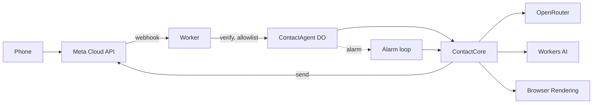

# wapp-agent

A WhatsApp assistant that remembers you. It runs on Cloudflare Workers. One Durable Object per contact keeps that person's chat, facts and insights in SQLite. Nothing is shared between contacts.

Repo: https://github.com/aldaonggar/wapp-agent (branch `feat/wapp-agent`). Worker: https://wapp-agent.alda-onggar.workers.dev (`/health` returns `ok`).

What was asked: [init.md](init.md). What was decided and why: [design](docs/superpowers/specs/2026-11-04-whatsapp-memory-agent-design.md). Manual setup done by the owner: [SETUP.md](SETUP.md). Verified API notes: [docs/superpowers/research/](docs/superpowers/research/).

## What it does and how to text it

Caveat: nothing has been exercised end to end from a phone yet (pending the owner's Meta setup), and no real-model eval has run; everything below is covered by offline tests with stub models only.

- Replies like a person: it waits for a burst of messages to finish, then answers in short bubbles.
- Reads photos, transcribes voice notes, and fetches pages for links you send.
- Remembers facts across days, works out things you did not say (insights), and forgets on request.
- Checks in later about plans that have a date.

To try it, the owner must first add your WhatsApp number to Meta's recipient list ([SETUP.md section 7](SETUP.md)). Meta's test number only talks to numbers on that list. The number to text is Meta's test number, shown in the owner's Meta dashboard (API Setup page). You must text first; the bot cannot start a chat.

Things to try:

1. Send three short messages in a row. You should get one reply that covers all three.
2. Send a photo and ask about it.
3. Send a voice note.
4. Send a link.
5. Ask "what do you know about me".
6. Say "forget ..." and a fact. Ask about it later.
7. Come back the next day and refer to something you said earlier.
8. Mention a plan with a date (for example a trip next week) and wait for the check-in.

## Architecture



- `src/worker.ts` re-exports `src/index.ts` (verify signature, check allowlist, fan out to one Durable Object per contact) and the `ContactAgent` class.
- `ContactAgent` ([src/contact-agent.ts](src/contact-agent.ts)) holds SQLite and one alarm. `ContactCore` ([src/core/contact.ts](src/core/contact.ts)) holds the logic and has no Cloudflare imports, so tests and evals run it in plain Node.
- OpenRouter: reply, extraction, insights. Workers AI: bge-m3 embeddings and rerank, Whisper. Browser Rendering: `/snapshot` for links.
- Alarm loop: wait for the burst to end, run the turn, then remember (extract facts) off the reply path so the next reply never waits for it; derive insights after 30 minutes of quiet, then check follow-ups.

## Repo map

`src/`

- [worker.ts](src/worker.ts): wrangler entry; re-exports the Worker and `ContactAgent`.
- [index.ts](src/index.ts): `/webhook` GET and POST, allowlist, fan-out, `/health`.
- [contact-agent.ts](src/contact-agent.ts): Durable Object shell and dependency wiring.
- [env.d.ts](src/env.d.ts): `Env` augmentation (secret names, `CONTACT` binding).
- [models.ts](src/models.ts): model table, per-job defaults and candidates, prices, cost, host filter.
- [llm.ts](src/llm.ts): streaming and structured calls over the AI SDK and OpenRouter.
- [whatsapp.ts](src/whatsapp.ts): webhook parsing, Graph API client, signature check.
- [browser.ts](src/browser.ts): URL extraction and Browser Rendering snapshots.
- [workers-ai.ts](src/workers-ai.ts): embeddings, rerank, transcription.
- `*.test.ts` next to each file: unit tests.

`src/core/`

- [types.ts](src/core/types.ts): shared types.
- [db.ts](src/core/db.ts): schema, migrations, SQLite adapters, vector helpers.
- [cadence.ts](src/core/cadence.ts): when a burst is over; pauses between bubbles.
- [stream.ts](src/core/stream.ts): parses the model's reply into bubbles.
- [prompt.ts](src/core/prompt.ts): system prompt, history window, prompt assembly.
- [contact.ts](src/core/contact.ts): `ContactCore`: ingest, alarm, turn, scheduling.
- [memory.ts](src/core/memory.ts): remember, recall, forget, profile.
- [insights.ts](src/core/insights.ts): derived insights.
- [followups.ts](src/core/followups.ts): schedule and decide proactive check-ins.
- [timezone.ts](src/core/timezone.ts): timezone guess from the phone's country code.

`evals/`

- [run.ts](evals/run.ts): `npm run eval` CLI (flags become env, then vitest).
- [harness.ts](evals/harness.ts): fake clock and WhatsApp, scenario loader and runner.
- [judge.ts](evals/judge.ts): LLM judge for probes and facts.
- [report.ts](evals/report.ts): `evals/results/*.json` to [EVALS.md](EVALS.md).
- [scenarios.test.ts](evals/scenarios.test.ts): one test per scenario (real models).
- [harness.test.ts](evals/harness.test.ts), [cadence.test.ts](evals/cadence.test.ts): offline tests with a stub model.
- [scenarios/](evals/scenarios): 21 YAML scenarios. [fixtures/photo.jpg](evals/fixtures/photo.jpg): test image.

Docs and config

- [init.md](init.md): the original brief.
- [SETUP.md](SETUP.md): owner's manual setup.
- [EVALS.md](EVALS.md): generated eval report (currently "not run").
- [docs/superpowers/specs/](docs/superpowers/specs): design. [plans/](docs/superpowers/plans): task plan. [research/](docs/superpowers/research): API notes.
- [package.json](package.json), [tsconfig.json](tsconfig.json), [vitest.config.ts](vitest.config.ts), [wrangler.jsonc](wrangler.jsonc): config.

## Evals

Built: a harness that replays scripted conversations with a fake clock, an LLM judge, 21 scenarios and a reporter. Not done: **no real-model run has happened.** It needs `OPENROUTER_API_KEY`, which is not available yet. [EVALS.md](EVALS.md) is generated in its "not run" state, so it has no numbers to quote.

The 21 scenarios by category: short-term 7, long-term 6, derived 4, judgement 2, forget 1, isolation 1.

```bash
npm run eval                                   # all scenarios, default models
npm run eval -- --reply=moonshotai/kimi-k2.6   # swap the reply model
npm run eval -- --extract=<id> --derive=<id>   # swap extraction or insight model
npm run eval -- --effort=high                  # reasoning effort: low | medium | high
npm run eval -- --no-memory                    # baseline without memory
npm run eval -- --retrieval=cosine             # cosine only instead of hybrid
npm run eval -- --filter=forget                # scenarios whose name matches a regex
npm run eval:report                            # results -> EVALS.md
```

Tests that run today (offline): `npm test` is 175 tests in 15 files; `npx vitest run evals/harness.test.ts evals/cadence.test.ts` is 34 tests in 2 files; `npm run types && npx tsc --noEmit` is clean (`npm run types` generates `worker-configuration.d.ts`, which is git-ignored, so run it first on a fresh clone).

## Model picks

These are the cheapest in each row by OpenRouter list price (2026-11-04). The comparison that would confirm them has not run, so treat them as unproven defaults. Defaults and candidates are in [src/models.ts](src/models.ts); override with `MODEL_REPLY`, `MODEL_VISION`, `MODEL_EXTRACT`, `MODEL_DERIVE`.

| Job | Default | Input / output per 1M tokens |
|---|---|---|
| Reply | `deepseek/deepseek-v4.1-flash` | $0.045 / $0.50 |
| Vision (photos) | the reply model when it accepts images (the default does); `openai/gpt-6.1-terra` only when the reply model is text-only | $1 / $5 for `openai/gpt-6.1-terra` |
| Extract | `deepseek/deepseek-v4.1-flash` | $0.045 / $0.50 |
| Derive insights | `deepseek/deepseek-v4-pro` | $1.60 / $3.20 |
| Eval judge | `anthropic/claude-opus-5.5` | $4 / $20 |

Calls to DeepSeek, Moonshot and Z.ai models exclude China- and Singapore-hosted providers (`CHINA_HOSTS` in `src/models.ts`). The host that served each call is logged.

## Running it

```bash
npm install
npm run types      # generates worker-configuration.d.ts (git-ignored); needed before npx tsc --noEmit
npm run dev        # wrangler dev, reads .dev.vars
npm run deploy
npm test
npm run eval
```

`.dev.vars` (git-ignored) holds eight names: `WHATSAPP_PHONE_NUMBER_ID`, `WHATSAPP_APP_SECRET`, `WHATSAPP_TOKEN`, `WHATSAPP_VERIFY_TOKEN`, `CLOUDFLARE_API_TOKEN`, `CLOUDFLARE_ACCOUNT_ID`, `OPENROUTER_API_KEY`, `ALLOWED_PHONES`. Where each comes from is in [SETUP.md](SETUP.md).

## Known limits

- Replies only within 24 hours of the person's last message (Meta rule). Proactive check-ins outside that window are skipped.
- Meta's test number only talks to a small list of verified recipient numbers.
- Cloudflare Free plan: Browser Rendering is 10 minutes per day and one page request per 10 seconds; Workers AI is 10,000 neurons per day (about 200 minutes of voice notes).
- Meta's free tier is 1,000 delivered service messages per month per number. No payment method is on file. The status webhook's `pricing.type` flip is logged.
- No voice replies.
- Timezone is guessed from the phone's country code until the person says where they are.
- The model comparison has not run (see Evals).
- Follow-ups never retry.
- The extractor sees only the current turn.

## What I would build next

- Follow-ups outside the 24-hour window, using approved message templates.
- Voice replies.
- Run the model comparison once the OpenRouter key exists, then set the defaults from the results.

## Credits

Extraction prompts are adapted from the open-source prompts of [mem0](https://github.com/mem0ai/mem0) (Apache-2.0).
